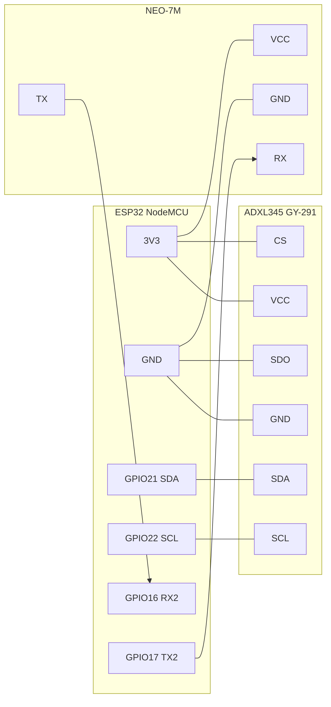

# 1. Hardware

## Bill of materials

| Part | Notes |
|---|---|
| ESP32 NodeMCU / DevKit V1 (ESP32-WROOM-32) | the "classic" 30/38-pin board |
| ADXL345 breakout (GY-291) | 3-axis accelerometer, I2C |
| u-blox NEO-7M breakout (GY-NEO7M) + active/patch antenna | GPS, UART, 9600 baud default |
| Jumper wires, small perfboard / enclosure | something rigid |
| USB cable + 5 V source in the car (USB car charger / power bank) | the ESP32 is powered over USB |

## Pinout

All pin numbers are defined once in [`components/board/include/board_pins.h`](../components/board/include/board_pins.h).

### ADXL345 (GY-291) — I2C

| ADXL345 pin | ESP32 pin | Why |
|---|---|---|
| VCC | **3V3** | 3.3 V logic |
| GND | **GND** | |
| SDA | **GPIO21** | I2C data (default I2C SDA) |
| SCL | **GPIO22** | I2C clock (default I2C SCL) |
| CS | **3V3** | high = I2C mode (most GY-291 boards already pull it up) |
| SDO / ALT ADDR | **GND** | selects I2C address **0x53** (the firmware expects it) |
| INT1, INT2 | not connected | the firmware polls the FIFO instead |

### NEO-7M (GY-NEO7M) — UART2

| NEO-7M pin | ESP32 pin | Why |
|---|---|---|
| VCC | **3V3** (or **VIN/5V** if your board has the on-board 3.3 V regulator — most GY-NEO7M do) | |
| GND | **GND** | |
| TX | **GPIO16** (RX2) | GPS → ESP32 (NMEA sentences) |
| RX | **GPIO17** (TX2) | ESP32 → GPS (UBX config: 5 Hz, fewer sentences) |
| PPS | not connected | optional; blinks once per second when the GPS has a fix |

> TX goes to RX and RX goes to TX. Swapping them is the most common
> reason for "no NMEA data".

### Status LED

The on-board blue LED (**GPIO2**) is used by `esp32_iot`:

| LED | Meaning |
|---|---|
| off | no data from the GPS (check wiring) |
| slow blink | GPS talking, no fix yet (go outside; first fix can take 30 s – 5 min) |
| solid on | GPS fix |
| 3 quick flashes | an event was published to AWS IoT |

## Wiring diagram

```
   ADXL345 (GY-291)            ESP32 NodeMCU             NEO-7M (GY-NEO7M)
  ┌──────────────┐          ┌─────────────────┐          ┌──────────────┐
  │ VCC ─────────┼──────────┤ 3V3         3V3 ├──────────┼───────── VCC │
  │ GND ─────────┼──────────┤ GND         GND ├──────────┼───────── GND │
  │ SDA ─────────┼──────────┤ GPIO21   GPIO16 ├◄─────────┼────────── TX │
  │ SCL ─────────┼──────────┤ GPIO22   GPIO17 ├─────────►┼────────── RX │
  │ CS  ── 3V3   │          │                 │          │ PPS  (n.c.)  │
  │ SDO ── GND   │          │ GPIO2 = LED     │          └──────────────┘
  └──────────────┘          └─────────────────┘
```



## Pins to avoid on the classic ESP32

- GPIO 6–11: connected to the flash chip.
- GPIO 0, 2, 5, 12, 15: strapping pins (GPIO2 is fine as an *output* LED).
- GPIO 34–39: input only, no pull-ups.
- On WROVER modules GPIO16/17 are used by PSRAM — this project assumes
  WROOM (no PSRAM). If you have a WROVER, change `BOARD_GPS_RX/TX` to
  e.g. GPIO26/GPIO27.

## Mounting — this matters as much as the ML

The model sees the car through the sensor; a wobbly mount adds its own
vibrations and makes potholes and humps look alike.

1. Fix the ADXL345 **rigidly** to the vehicle body/chassis (screw or strong
   double-sided mounting tape to a hard surface; not on foam, not on a
   phone holder arm, not hanging from wires).
2. Orientation does **not** matter — the firmware estimates gravity and
   works in "vertical" and "horizontal" components. It does have to stay
   fixed during and between recordings.
3. Mount it close to the middle of the car (between the axles) if you can;
   use the same position for data collection and deployment.
4. GPS antenna: facing the sky (dashboard / under the windscreen). It will
   not get a fix indoors.

## Bring-up checklist

1. Flash `esp32_inference` (see [02-firmware.md](02-firmware.md)) and open the monitor.
2. You should see `ADXL345 ... ready: 100 Hz, +/-8 g, FIFO stream`.
   - `No answer on I2C` → check SDA/SCL, CS→3V3, SDO→GND, power.
   - `DEVID 0x.., expected 0xE5` → not an ADXL345 or wrong address.
3. After 2 s: `ready - waiting for road events`. Tap the sensor sharply —
   an `EVENT ...` block must appear.
4. Every 10 s a `[gps]` line appears:
   - `no NMEA data` → GPS TX is not on GPIO16 / no power.
   - `receiving, waiting for fix` → wiring OK; go outside.
   - `fix 12.97..., 79.15...` → done.

## Raspberry Pi Pico W instead of the ESP32?

Possible but not recommended for this project — see
[04-ml-pipeline.md § Hardware alternatives](04-ml-pipeline.md#hardware-alternatives-pico-1-wh-pytorch-on-cortex-m).
