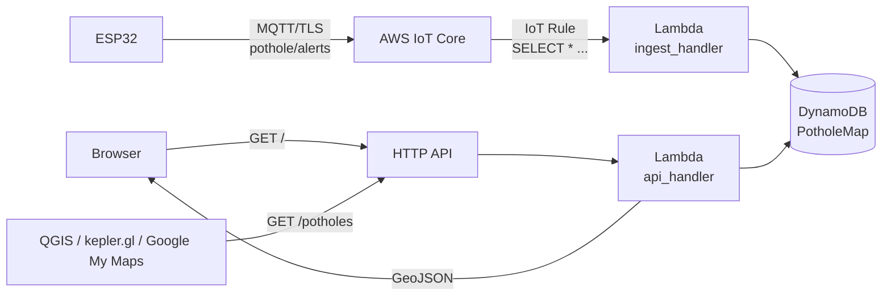

# 5. Cloud backend & GIS map

The ESP32 already publishes to AWS IoT Core on `pothole/alerts`. This step
turns those messages into a live map.



Everything is in [`cloud/`](../cloud):

| File | What |
|---|---|
| `cloud/template.yaml` | AWS SAM template: DynamoDB table, 2 Lambdas, IoT rule, HTTP API |
| `cloud/src/potholes.py` | ingest + API code (Python 3.12, boto3 only) |
| `cloud/src/map.html` | the web map (Leaflet + OpenStreetMap tiles, no API key) |
| `cloud/tests/test_potholes.py` | offline test with an in-memory table |

## How the map works

- Every message is stored as a raw **report** (kept 90 days via DynamoDB TTL).
- Reports **with a GPS fix and HDOP ≤ 5** are folded into a map **cell**
  (geohash-8, about 38 m × 19 m). Repeated detections of the same pothole by
  any car increase its `reports` count instead of adding a new pin — the
  count is your confidence that the pothole is real.
- The API merges neighbouring cells within 15 m (a pothole on a cell border)
  and returns GeoJSON:

```json
{"type":"FeatureCollection","features":[{"type":"Feature",
  "geometry":{"type":"Point","coordinates":[79.1588,12.97161]},
  "properties":{"event":"POTHOLE","reports":3,"devices":2,"confidence":0.9,
                "max_severity_g":2.0,"first_seen":1760696553400,"last_seen":1760696613400}}]}
```

- `GET /potholes?type=POTHOLE&min_reports=2` filters; the map has the same
  controls and refreshes every 30 s.

> **Deployed 2026-10-22** — the actual deployment log, resource list and
> verification are in [08-aws-deployment.md](08-aws-deployment.md).

## Register the device in your account

```bash
cloud/provision_device.sh ap-south-1 pothole-esp32
```

Creates the IoT thing, an active certificate (`esp32_iot/certs/`), the
publish-only policy, and writes your account's endpoint into
`esp32_iot/main/secrets.h`. Then rebuild and flash `esp32_iot`.

## Deploy with AWS SAM (recommended, ~10 minutes)

Prerequisites: an AWS account (the one with your IoT thing), the region you
used for IoT Core (your endpoint says **ap-south-1**).

1. Install the tools:
   ```bash
   pip install awscli aws-sam-cli        # or see the AWS docs for installers
   aws configure                         # access key of an IAM user/role with admin or
                                         # CloudFormation+IAM+Lambda+DynamoDB+IoT+API GW rights
   ```
2. Deploy:
   ```bash
   cd cloud
   sam build
   sam deploy --guided --region ap-south-1
   #   Stack name: pothole-map
   #   AlertTopic [pothole/alerts]: <enter>
   #   Allow SAM CLI IAM role creation: Y
   #   ApiFunction has no authentication. Is this okay?: y   (it's a read-only public map)
   #   Save arguments to samconfig.toml: Y
   ```
3. The outputs print `MapUrl` and `GeoJsonUrl`. Open `MapUrl`.

Later changes: `sam build && sam deploy`. Remove everything: `sam delete`.

## Test without driving

In the AWS console → **IoT Core → MQTT test client → Publish to a topic**,
topic `pothole/alerts`, payload:

```json
{"device_id":"test","event":"POTHOLE","confidence":0.9,"severity_g":1.5,
 "lat":12.9716,"lon":79.1588,"coordinates":[12.9716,79.1588],
 "gps":{"fix":true,"sats":8,"hdop":1.0,"speed_kmh":25}}
```

or from a terminal (AWS CLI v2; on v1, as installed by `pip install awscli`, drop `--cli-binary-format raw-in-base64-out`):

```bash
aws iot-data publish --region ap-south-1 --topic pothole/alerts \
  --cli-binary-format raw-in-base64-out \
  --payload '{"device_id":"test","event":"POTHOLE","confidence":0.9,"severity_g":1.5,"lat":12.9716,"lon":79.1588,"gps":{"fix":true,"hdop":1.0}}'
```

Reload the map — a red marker appears. Logs: CloudWatch → Log groups →
`/aws/lambda/pothole-map-IngestFunction-...` (each message logs `mapped` or
`skipped` with the reason, e.g. `no GPS fix`).

Offline unit test (no AWS needed): `pip install boto3 && python cloud/tests/test_potholes.py`.

## Deploy by hand in the console (if you prefer clicking)

1. **DynamoDB** → Create table `PotholeMap`, partition key `PK` (String),
   sort key `SK` (String), on-demand. Then *Additional settings → TTL* →
   attribute `ttl`.
2. **Lambda** → Create function `pothole-ingest`, Python 3.12. Paste
   `cloud/src/potholes.py`, set handler to `lambda_function.ingest_handler`
   (if you keep the default file name `lambda_function.py`), environment
   variable `TABLE_NAME=PotholeMap`. In *Configuration → Permissions* add
   the AWS-managed policy `AmazonDynamoDBFullAccess` (or a narrower one).
3. **IoT Core → Message routing → Rules** → Create rule:
   SQL `SELECT *, timestamp() AS received_ms, clientid() AS clientid FROM 'pothole/alerts'`,
   action **Lambda** → `pothole-ingest`.
4. **Lambda** → second function `pothole-api` with the same code, handler
   `lambda_function.api_handler`, same `TABLE_NAME`, read access to the
   table. Also upload `map.html` next to the code (Lambda editor → New file).
5. **API Gateway** → Create **HTTP API**, integration `pothole-api`, routes
   `GET /` and `GET /potholes`. Open the invoke URL.

## Other GIS options

- **QGIS**: *Layer → Add Layer → Add Vector Layer → Protocol: HTTP(S)*,
  URL = `GeoJsonUrl`. Good for analysis/heatmaps.
- **kepler.gl** (web): load the GeoJSON for heatmaps/hexbins.
- **Google My Maps**: download the GeoJSON → convert to KML (e.g. with QGIS) → import.
- **Amazon Location Service**: if you want AWS-hosted basemaps instead of
  OpenStreetMap tiles, create a Map resource + API key and swap the
  `L.tileLayer(...)` line in `map.html` for MapLibre with that style.
  OpenStreetMap tiles are fine for a project/demo; for heavy public traffic
  use a tile provider per the OSM tile usage policy.

## Costs

For a handful of devices this stays within the AWS free tier: IoT Core
messages, Lambda invocations, DynamoDB on-demand, HTTP API requests are all
cents per month.

## Ideas for later

- Mark potholes as fixed (add `status`, a small authenticated `POST`).
- Decay old reports (`last_seen` older than N months → grey marker).
- Device shadow / OTA to push a retrained model to all devices.
