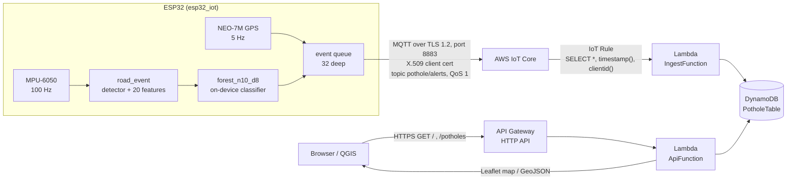

# 8. AWS deployment report

*Deployed and verified end-to-end on 2026-10-22.*

This is the record of how the cloud side was actually brought up: which AWS
services are used, what each resource does, the exact commands, how it was
verified, and the problems hit on the way. [05-cloud-gis.md](05-cloud-gis.md)
explains the map design; this document is the deployment log and runbook.

> Account IDs, the IoT endpoint, the API URL and recorded coordinates are
> deliberately **not** in this public repository. They are printed by the
> commands below (`aws sts get-caller-identity`, `provision_device.sh`,
> `sam deploy` outputs).

## 1. End-to-end data flow



Latency from the wheel hitting a pothole to the pin being in the database is
the 1 s post-trigger window + one MQTT round trip + one Lambda invocation —
in practice about 1.5–2 s. The map polls every 30 s.

## 2. AWS services used

| Service | Resource(s) | Role in the system | Created by |
|---|---|---|---|
| **AWS IoT Core** | Thing `pothole-esp32` | the device's identity in the registry | `cloud/provision_device.sh` |
| | X.509 certificate (active) | mutual-TLS authentication of the ESP32 | `provision_device.sh` |
| | Policy `PotholeDevicePolicy` | allows `iot:Connect` and `iot:Publish` to `pothole/alerts` only | `provision_device.sh` |
| | Device data endpoint (`…-ats.iot.ap-south-1.amazonaws.com`) | MQTT broker the ESP32 connects to | AWS (per account/region) |
| | Topic rule `IngestFunctionAlertRule…` | forwards every message on `pothole/alerts` to Lambda, adding `received_ms` and `clientid` | SAM template |
| **AWS Lambda** | `IngestFunction` (Python 3.12, arm64, 256 MB) | validates a report, stores it, folds it into a map cell | SAM template |
| | `ApiFunction` (same runtime) | serves the map page and the GeoJSON feed | SAM template |
| **Amazon DynamoDB** | `PotholeTable` (on-demand, TTL on `ttl`) | raw reports (90 days) + aggregated map cells | SAM template |
| **Amazon API Gateway** | HTTP API, `$default` stage, routes `GET /`, `GET /potholes` | public, read-only HTTPS front door | SAM template |
| **AWS IAM** | `IngestFunctionRole` (DynamoDB CRUD), `ApiFunctionRole` (DynamoDB read) | least-privilege execution roles | SAM template |
| **AWS CloudFormation** | stack `pothole-map` | owns every SAM resource; update/delete as one unit | `sam deploy` |
| **Amazon S3** | `aws-sam-cli-managed-default-samclisourcebucket-…` | holds the zipped Lambda code during deploys | `sam deploy --resolve-s3` |
| **Amazon CloudWatch Logs** | `/aws/lambda/pothole-map-IngestFunction-…`, `…ApiFunction-…` | one log line per message (`mapped` / `skipped` + reason) | Lambda (automatic) |

Region: **ap-south-1 (Mumbai)** for everything.

### Why these services

- **IoT Core** instead of a self-hosted MQTT broker (Mosquitto on EC2): no
  server to run, per-device X.509 certificates and policies, and rules that
  route messages to other AWS services without any glue code.
- **Lambda + DynamoDB** instead of an always-on database server: the load is
  a few messages per minute, so pay-per-request costs effectively nothing and
  scales without changes.
- **API Gateway HTTP API** (not REST API): cheaper and simpler; only two GET
  routes are needed.
- **Leaflet + OpenStreetMap** as the GIS layer: no API key or billing, and the
  same data is available as standard **GeoJSON** for QGIS, kepler.gl or
  Google My Maps.
- **SAM / CloudFormation**: the whole backend is one versioned
  file (`cloud/template.yaml`), deployed, updated and deleted with one
  command each.

## 3. Message contract

Published by the device, QoS 1, ~350 bytes:

```json
{"device_id":"pothole-6acecc","event":"POTHOLE","confidence":0.75,"severity_g":0.98,
 "coordinates":[<lat>,<lon>],"lat":<lat>,"lon":<lon>,
 "gps":{"fix":true,"sats":7,"hdop":2.4,"speed_kmh":0.5,"age_ms":1167},
 "utc":"2026-10-21T21:38:06.800Z","uptime_ms":74668,"model":"forest_n10_d8"}
```

The IoT rule adds `received_ms` (broker timestamp) and `clientid`
(`ESP32_<MAC>`, the esp-mqtt default).

The ingest Lambda **maps** a report only if `event` is `POTHOLE` or
`SPEED_HUMP`, coordinates are present and valid (not 0,0), and
`gps.hdop ≤ 5`. Everything else is still stored as a raw report with the
reason (`no GPS fix`, `poor GPS (hdop 9)`, …) so it can be audited.

## 4. DynamoDB data model (single table)

| PK | SK | Item | Lifetime |
|---|---|---|---|
| `REPORT#<device_id>` | `<received_ms>` | raw payload, `mapped`, `reason` | 90 days (TTL) |
| `CELL#<geohash-8>` | `TYPE#POTHOLE` / `TYPE#SPEED_HUMP` | running sums `n`, `lat_sum`, `lon_sum`, `conf_sum`, set of `devices`, `max_severity`, `first_seen`, `last_seen` | permanent |

A geohash-8 cell is about 38 m × 19 m. Updates use atomic `ADD`, so many
devices can report the same pothole concurrently without read-modify-write
races. At read time the API merges neighbouring cells within 15 m of each
other (a pothole on a cell border), so **repeat reports of one pothole become
one pin whose report count is its confidence**.

## 5. What was done, step by step

### 5.1 Dev environment on this machine

| Tool | Version | Source |
|---|---|---|
| ESP-IDF | v6.1 (dev) | `~/esp-idf` on the Fedora partition |
| xtensa-esp-elf-gcc | 15.2.0 | `~/.espressif/tools` (Fedora partition) |
| IDF Python env | Python 3.13 (miniconda) | `~/.espressif/python_env/idf6.1_py3.13_env` |
| AWS CLI | 1.46 | `pip`, in `cloud/.venv` (git-ignored) |
| AWS SAM CLI | 1.169 | `pip`, in `cloud/.venv` |
| Python | 3.12 (system) | Lambda tests, ML scripts |

The ESP-IDF install lives on the Fedora btrfs partition and its Python venv
has absolute `/home/jonny/...` paths baked in. To reuse it unchanged from
Ubuntu:

```bash
udisksctl mount -b /dev/nvme0n1p3                       # -> /media/jonny/fedora
F=/media/jonny/fedora/home/jonny
ln -s $F/esp-idf ~/esp-idf; ln -s $F/.espressif ~/.espressif; ln -s $F/miniconda3 ~/miniconda3

export PATH=$HOME/miniconda3/bin:$PATH    # export.sh picks the venv by python3's version (3.13)
. ~/esp-idf/export.sh
```

```bash
cd cloud && python3 -m venv .venv && .venv/bin/pip install awscli aws-sam-cli boto3
```

### 5.2 AWS credentials

An access key was configured for the CLI (`aws configure`, region
`ap-south-1`, stored in `~/.aws/credentials`, never in the repo).
**It is a root-account key** — acceptable to bootstrap, but it should be
replaced by an IAM user key and then deleted (see §9).

### 5.3 Register the device — `cloud/provision_device.sh`

```bash
export PATH=$PWD/cloud/.venv/bin:$PATH
cloud/provision_device.sh ap-south-1 pothole-esp32
```

The script is idempotent and does:

1. `iot create-thing` → `pothole-esp32`
2. `iot create-policy` → `PotholeDevicePolicy`:
   ```json
   {"Version":"2012-10-17","Statement":[
     {"Effect":"Allow","Action":"iot:Connect","Resource":"arn:aws:iot:<region>:<account>:client/*"},
     {"Effect":"Allow","Action":"iot:Publish","Resource":"arn:aws:iot:<region>:<account>:topic/pothole/alerts"}]}
   ```
3. `iot create-keys-and-certificate --set-as-active` → writes
   `esp32_iot/certs/certificate.pem.crt` and `private.pem.key` (mode 600),
   attaches the policy and the thing to the certificate
4. downloads **Amazon Root CA 1** → `esp32_iot/certs/aws_root_ca.pem`
5. `iot describe-endpoint --endpoint-type iot:Data-ATS` → writes
   `AWS_IOT_ENDPOINT` into `esp32_iot/main/secrets.h`

`secrets.h` (Wi-Fi SSID/password + endpoint) and `certs/` are git-ignored.

### 5.4 Build and flash the firmware

Only the credentials changed; no firmware source was modified.

```bash
cd esp32_iot
idf.py build
idf.py -p /dev/ttyUSB0 flash monitor
```

Serial output after flashing:

```
I (13792) POTHOLE_IOT: MQTT connected to AWS IoT
I (30940) POTHOLE_IOT: status: gps=fix sats=8 mqtt=up queued=0
```

Before this, the board ran a build with another account's endpoint
(`ap-southeast-2`) and Wi-Fi network, so it could neither join Wi-Fi nor
resolve the broker (`getaddrinfo() returns 202`).

### 5.5 Deploy the backend — AWS SAM

```bash
cd cloud
sam validate --lint
sam build
sam deploy --stack-name pothole-map --region ap-south-1 --resolve-s3 \
           --capabilities CAPABILITY_IAM
```

The first deploy was created as a change set, reviewed (11 resources, all
`Add`), then executed. Outputs:

| Output | Meaning |
|---|---|
| `MapUrl` | `https://<api-id>.execute-api.ap-south-1.amazonaws.com/` — the live map |
| `GeoJsonUrl` | `…/potholes` — GeoJSON feed (`?type=POTHOLE`, `?min_reports=2`) |
| `TableName` | `pothole-map-PotholeTable-…` |

Later code changes: `sam build && sam deploy` (same flags). Remove everything:
`sam delete --stack-name pothole-map --region ap-south-1`.

## 6. Verification

| Test | How | Result |
|---|---|---|
| Lambda logic offline | `python cloud/tests/test_potholes.py` (in-memory table) | all passed |
| Template | `sam validate --lint` | valid |
| Cloud path without the device | `aws iot-data publish` of a synthetic POTHOLE to `pothole/alerts` | appeared in `/potholes` within seconds; then deleted |
| Map page | `curl -o /dev/null -w %{http_code} <MapUrl>` | 200 |
| Full system | desk motions on the real board, GPS fix 7–8 satellites, HDOP 0.9–2.4 | 3 POTHOLE + 3 SPEED_HUMP reports received, all `mapped=True`; the 3 potholes merged into one pin with `reports: 3` |

Received reports from the device (coordinates omitted):

| UTC | Event | Confidence | Severity | Sats / HDOP |
|---|---|---|---|---|
| 21:34:14 | SPEED_HUMP | 0.72 | 0.79 g | 7 / 2.4 |
| 21:37:43 | SPEED_HUMP | 0.78 | 0.89 g | 8 / 0.9 |
| 21:38:06 | POTHOLE | 0.75 | 0.98 g | 7 / 2.4 |
| 21:40:07 | SPEED_HUMP | 0.71 | 0.99 g | — |
| 21:40:34 | POTHOLE | 0.73 | 0.66 g | — |
| 21:41:09 | POTHOLE | 0.64 | 0.80 g | — |

Useful checks later:

```bash
aws logs tail /aws/lambda/<IngestFunction name> --follow --region ap-south-1
aws dynamodb scan --table-name <TableName> --region ap-south-1 \
    --filter-expression "begins_with(PK,:p)" \
    --expression-attribute-values '{":p":{"S":"REPORT#"}}'
```

IoT Core → *MQTT test client* → subscribe to `pothole/alerts` shows the live
messages from the board.

## 7. Problems hit and fixes

| Problem | Symptom | Cause | Fix |
|---|---|---|---|
| Board never reached AWS | `Wi-Fi disconnected, reconnecting...`, `couldn't get hostname for …ap-southeast-2…` | firmware still had another person's Wi-Fi, endpoint and certs | `provision_device.sh` + new `secrets.h`, rebuild, flash |
| Serial monitor showed garbage | unreadable bytes right after reset | ROM bootloader prints at 74 880 baud | ignore; the app logs at 115 200 |
| `export.sh` refused to run | `idf6.1_py3.12_env ... not found` | Ubuntu's python3 is 3.12; the existing venv is 3.13 | put the Fedora miniconda first on `PATH` |
| `aws iot-data publish` rejected the payload flag | `Unknown options: --cli-binary-format` | flag only exists in AWS CLI v2; pip installs v1 | omit it on v1 (payload is sent as-is) |
| **"Only speed humps are logged"** | potholes missing on the map although the API returned them | all desk events are within metres; a hump marker drawn *after* the pothole covered it at zoom 16 | `map.html`: draw potholes last (on top), allow auto-zoom to 18 |

## 8. Cost

All usage is inside the AWS Free Tier for a handful of devices: IoT Core
messages (≈ $1 per million after free tier), Lambda requests, DynamoDB
on-demand reads/writes, HTTP API requests (≈ $1 per million), a few KB of S3
and CloudWatch logs. Expected bill for this project: **≈ $0**.

## 9. Security notes and to-dos

- The map API is public and read-only; it exposes positions and timestamps,
  not keys. Put a Cognito/JWT authorizer on it if locations are sensitive.
- The device can only connect and publish to one topic; it cannot subscribe
  or read anything.
- The ingest Lambda has no public endpoint — only the IoT rule can invoke it.
- **To do:** create an IAM user (or IAM Identity Center user) for the CLI,
  switch `~/.aws/credentials` to it, then delete the **root access key**
  (IAM → *Security credentials*) and any plain-text copies of it.
- Certificate rotation and narrowing `client/*` to `client/ESP32_*`:
  see [06-security.md](06-security.md).
