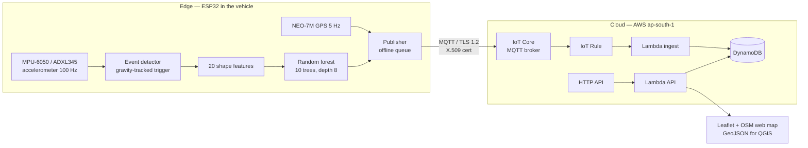

# 9. Project report — IoT pothole detection with on-device ML and an AWS GIS map

*Cloud Computing project · status as of 2026-10-22*

## Abstract

A low-cost device (ESP32 + accelerometer + GPS modules) mounted in
a vehicle detects road events, classifies each one **on the device** as
*pothole*, *speed hump* or *normal* with a 17 KB random-forest model, and
publishes potholes and humps with their GPS position over MQTT/TLS to
**AWS IoT Core**. A serverless backend (IoT Rule → Lambda → DynamoDB → HTTP
API) aggregates reports from any number of vehicles into a live web map and a
GeoJSON feed. The full chain — sensor to pin on the map — works and was
verified on 2026-10-22. The model is trained on simulated and desk-recorded
motions and still has to be validated on real roads.

## 1. Problem and goals

Potholes damage vehicles and cause accidents, and road authorities learn
about them late, from complaints. Goals:

1. Detect potholes automatically while driving, with cheap hardware.
2. Tell potholes from speed humps (both are big vertical jolts).
3. Put every detection on a shared map with its location, and grow
   confidence when several vehicles report the same spot.
4. Keep the device cheap and low-bandwidth: classify locally, send only events.

## 2. System architecture



**Edge computing split:** raw data is 100 samples/s × 3 axes; sending it
would cost ~1 KB/s per vehicle. The device sends ~350 bytes **per event**
instead, so a phone hotspot is enough and the cloud only stores results.

## 3. Hardware

| Part | Purpose | Interface |
|---|---|---|
| ESP32 DevKit V1 (WROOM-32, 2× 240 MHz, Wi-Fi) | detection, inference, networking | — |
| MPU-6050 (GY-521) — or ADXL345, auto-detected | acceleration, ±8 g @ 100 Hz | I2C, GPIO21/22 |
| u-blox NEO-7M | position, speed, time; configured to 5 Hz | UART2, GPIO16/17 |
| On-board LED (GPIO2) | off = no GPS, blinking = searching, on = fix, 3 flashes = published | GPIO |

Details and mounting: [01-hardware.md](01-hardware.md).

## 4. Firmware (ESP-IDF v6.1, C)

| Module | Responsibility |
|---|---|
| `components/accel` | I2C driver for both sensors; sample-exact 100 Hz (MPU-6050 polled on DATA_RDY because its byte FIFO desynchronised) |
| `components/neo7m_gps` | NMEA RMC/GGA parser with checksum, UBX config, fix freshness |
| `components/road_event` | gravity tracking, trigger, 1.5 s window, 20 features — **same C file is used by the Python trainer** |
| `components/pothole_model` | model header generated by `ml/train.py` |
| `esp32_iot/main/main.c` | FreeRTOS tasks: sensor (core 1, high priority), publish (MQTT), LED/status; Wi-Fi and MQTT reconnect; 32-event offline queue |

Key behaviours:

- The GPS position is captured **at the trigger instant**, not after the
  1 s classification window, so the pin is where the wheel hit.
- Only `POTHOLE` and `SPEED_HUMP` with confidence ≥ 0.6 are published;
  `NORMAL` events never leave the device.
- Detection runs without network; events are queued and sent after
  reconnecting.

Two other firmware projects support the ML work: `esp32_collector`
(streams raw samples for recording) and `esp32_inference` (offline bench
test). See [02-firmware.md](02-firmware.md).

## 5. Machine learning

### 5.1 Pipeline

```
collect.py  → data/<label>/*.csv (+ marks)       guided or free recording over serial
simulate.py → data/synthetic                     quarter-car model, ISO 8608 road roughness
augment.py  → data/bench_aug                     rotations, scaling, time-stretch, noise
dataset.py  → events + features                  firmware's C detector via ctypes
train.py    → pothole_model.h + model/report.md  model search, session-grouped CV, C export
```

### 5.2 Event detection

A slow low-pass filter tracks the gravity vector, so the sensor can be
mounted at any angle. Each sample is split into vertical dynamic
acceleration `v = a·ĝ − |g|` and horizontal `h`. `|v| > 0.25 g` triggers an
event; the window is 0.5 s before + 1.0 s after the trigger (150 samples).
Flat road never triggers, so it is never classified — the main defence
against false positives.

### 5.3 Features (20)

Size (`v_max`, `v_min`, `v_p2p`, `v_std`, `v_mean`), **shape and order**
(`first_peak`: drop-first = pothole, lift-first = hump; `t_max_minus_t_min`;
`skew`), duration (`active_time`), sharpness (`jerk_max`, `hf_ratio`,
`crest`, `kurtosis`), roll (`h_max`, `h_std`, `h_v_ratio`), oscillation
(`zcr`), road context (`pre_rms`), and signed areas (`neg_area`, `pos_area`).

### 5.4 Model selection

17 candidates (decision trees, random forests, extra-trees; 1–25 trees,
depth 3–8), class-balanced, scored by **macro-F1 with 5-fold
session-grouped cross-validation** (no recording session in both train and
test). The smallest model within 0.01 of the best wins.

| Model | CV macro-F1 | Nodes |
|---|---|---|
| forest 25 × d8 | 0.881 | 3 769 |
| **forest 10 × d8 (deployed)** | **0.877** | **1 452 (~17 KB)** |
| forest 10 × d6 | 0.846 | 736 |
| tree d8 | 0.780 | 157 |
| tree d3 | 0.632 | 15 |

Deployed model `forest_n10_d8`, 1 625 events from 58 sessions:

| | precision | recall | F1 |
|---|---|---|---|
| normal | 0.83 | 0.84 | 0.83 |
| speed hump | 0.91 | 0.89 | 0.90 |
| pothole | 0.89 | 0.91 | 0.90 |
| **macro avg** | **0.88** | **0.88** | **0.88** |

Most important features: `t_max_minus_t_min` (0.19), `first_peak` (0.13),
`skew`, `hf_ratio` — the order/shape cues. The earlier v1 pipeline (axis
min/max/mean statistics + one tree) scored 0.20–0.28 macro-F1 on the same
kind of data because it learnt the mounting angle, not the road.

### 5.5 Deployment on the microcontroller

The forest is exported to flat C arrays in flash with leaf probabilities
quantised to `uint8`; the exporter checks the C code agrees with
scikit-learn on 100 % of events. Inference takes microseconds. Leak-free
hold-out on real motions never seen in any form: **91 %** of drop-then-lift
motions → pothole, **80 %** of lift-then-down → speed hump.

Full details: [04-ml-pipeline.md](04-ml-pipeline.md), [model/report.md](../model/report.md).

## 6. Cloud and GIS (AWS)

| Layer | AWS service | Notes |
|---|---|---|
| Device identity & auth | IoT Core thing, X.509 certificate, IoT policy | mutual TLS; publish-only to `pothole/alerts` |
| Messaging | IoT Core MQTT broker | QoS 1, TLS 1.2, port 8883 |
| Routing | IoT Core rule | `SELECT *, timestamp() AS received_ms, clientid() AS clientid` |
| Processing | Lambda `IngestFunction` (Python 3.12, arm64) | validate, store raw report, aggregate per geohash-8 cell |
| Storage | DynamoDB (on-demand, single table, TTL) | raw reports 90 days; cells permanent |
| Serving | API Gateway HTTP API + Lambda `ApiFunction` | `GET /` map, `GET /potholes` GeoJSON |
| GIS | Leaflet + OpenStreetMap tiles; GeoJSON | also opens in QGIS / kepler.gl |
| Infrastructure as code | AWS SAM → CloudFormation stack `pothole-map` | one command to deploy/update/delete |
| Observability | CloudWatch Logs | `mapped` / `skipped: <reason>` per message |

**Crowd aggregation:** each report is folded into a ~38 m × 19 m geohash
cell with atomic counters; neighbouring cells within 15 m merge at read
time. One pothole reported by many vehicles is one marker whose size grows
with its report count. Reports without a fix or with HDOP > 5 are stored but
not mapped.

Deployment log, resources, commands and verification:
[08-aws-deployment.md](08-aws-deployment.md). Map design:
[05-cloud-gis.md](05-cloud-gis.md).

## 7. Tools and technologies

| Area | Tools |
|---|---|
| Embedded | ESP-IDF v6.1, FreeRTOS, esp-mqtt, mbedTLS, GCC 15 (xtensa-esp-elf), esptool, `idf.py monitor` |
| ML / data | Python 3, NumPy, SciPy, pandas, scikit-learn, pyserial, matplotlib, pytest, ctypes (shared C feature code) |
| Cloud | AWS IoT Core, Lambda, DynamoDB, API Gateway (HTTP API), CloudFormation, S3, CloudWatch, IAM; AWS CLI, AWS SAM CLI, boto3 |
| GIS | Leaflet 1.9, OpenStreetMap, GeoJSON, geohash; QGIS / kepler.gl compatible |
| Engineering | Git/GitHub, Markdown + Mermaid docs, offline unit tests for C, Python and Lambda code |

## 8. Results

- End-to-end verified on 2026-10-22: board on a phone hotspot, GPS fix with
  7–8 satellites (HDOP 0.9–2.4), 3 pothole and 3 speed-hump events
  published and all mapped; the three potholes merged into one pin with
  `reports: 3`.
- Event-to-database latency ≈ 1.5–2 s (dominated by the 1 s window).
- No false events at rest after the MPU-6050 warm-up fix.
- Cost: inside the AWS Free Tier (≈ $0/month for a few devices).

## 9. Limitations

- The model has only seen **simulated car physics and hand motions on a
  desk**, no real road data; real-road accuracy is unknown.
- No clean real pothole recordings: pothole training examples are mirrored
  real humps plus parametric events.
- GPS error (a few metres) is similar to pothole size; the 15 m merge
  radius hides this but also merges potholes that are very close together.
- The public map has no authentication and no way to mark potholes as fixed.

## 10. Future work

1. Record real drives (`ml/collect.py --guided`) and retrain on road data.
2. Mark-as-fixed and ageing of old reports (authenticated `POST`, grey markers).
3. OTA updates / device shadow to push new models to all vehicles.
4. A small 1-D CNN (TFLite Micro + ESP-NN) once several hundred real events per class exist.
5. Replace the root access key with an IAM user; narrow the IoT policy to `client/ESP32_*`.

## Documentation map

| Doc | Content |
|---|---|
| [01-hardware.md](01-hardware.md) | parts, wiring, mounting, bring-up |
| [02-firmware.md](02-firmware.md) | building, flashing, payload |
| [03-data-collection.md](03-data-collection.md) | recording labelled data |
| [04-ml-pipeline.md](04-ml-pipeline.md) | detector, features, model, design decisions |
| [05-cloud-gis.md](05-cloud-gis.md) | map backend design |
| [06-security.md](06-security.md) | credentials, certificates, policy |
| [07-status.md](07-status.md) | current status and problem log |
| [08-aws-deployment.md](08-aws-deployment.md) | AWS deployment log and runbook |
| [10-commands-and-links.md](10-commands-and-links.md) | shell commands and web links |
| [Pothole_Detection_System.pptx](Pothole_Detection_System.pptx) | 13-slide presentation |
| [report/Capstone_Report.pdf](report/Capstone_Report.pdf) | capstone-format report (also `.docx`) |
| [report/IEEE_Paper.pdf](report/IEEE_Paper.pdf) | IEEE conference paper (also `.docx` and LaTeX in `report/ieee_latex/`) |
